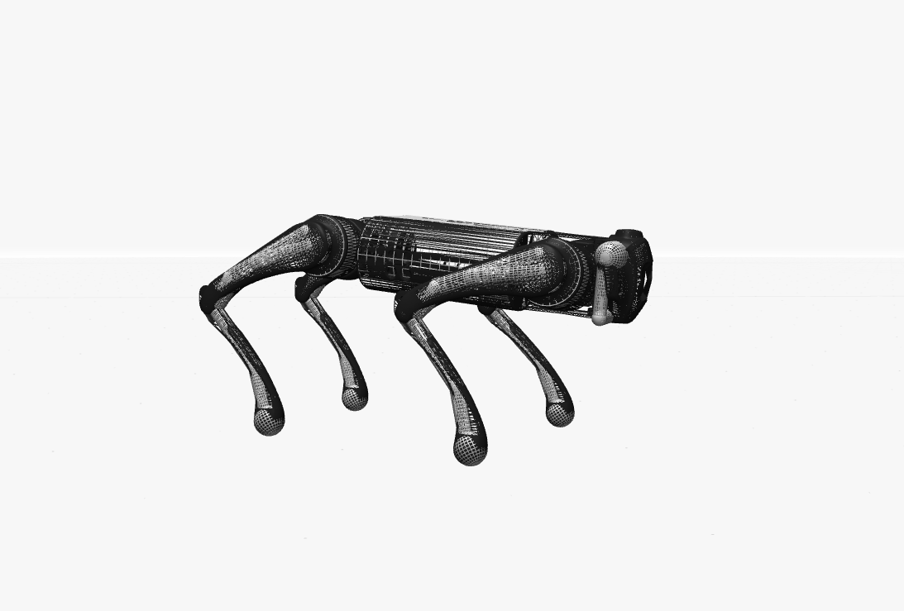

# PLASMA — Locomoción del robot cuadrúpedo Unitree Go1 mediante aprendizaje por refuerzo



**PLASMA** es un proyecto personal de inteligencia artificial cuyo objetivo es que un robot cuadrúpedo, el **Unitree Go1**, aprenda de forma autónoma a mantener el equilibrio y desplazarse dentro de un entorno de simulación física en 3D.

El comportamiento del robot no se programa de forma explícita. El robot aprende mediante **aprendizaje por refuerzo** (*Reinforcement Learning*): prueba acciones, recibe una recompensa o una penalización según el resultado y, con el tiempo, refuerza las acciones que le acercan a su objetivo.

---

## Objetivos del proyecto

El desarrollo está planteado por fases de complejidad creciente:

- **Fase 1 — Estabilidad:** mantenerse de pie de forma estable.
- **Fase 2 — Locomoción:** caminar con equilibrio y sin caídas.
- **Fase 3 — Recorrido:** desplazarse por un circuito sencillo y abstracto.
- **Fase 4 — Entorno urbano:** moverse por una ciudad simulada, saltar, escalar y desarrollar inteligencia espacial, es decir, interpretar el entorno que le rodea.

---

## Funcionamiento

El sistema se compone de cuatro elementos principales:

- **Entorno de simulación**
  - Define el "mundo" del robot: qué información percibe (posición, orientación, velocidad de sus articulaciones), qué acciones puede ejecutar y cuándo termina cada intento.
  - Se basa en el estándar Gymnasium, lo que permite conectarlo con cualquier algoritmo de aprendizaje compatible.

- **Función de recompensa**
  - Establece qué se considera un buen comportamiento.
  - Premia, por ejemplo, mantener el cuerpo estable y a la altura adecuada, y penaliza las caídas y los movimientos bruscos.
  - Es el elemento clave del proyecto: modificándola se orienta el aprendizaje del robot hacia nuevos objetivos, como caminar.

- **Algoritmo de entrenamiento: PPO** (*Proximal Policy Optimization*)
  - Ajusta de forma gradual la red neuronal que controla al robot para que repita las acciones que obtienen mayor recompensa.
  - Es uno de los algoritmos más utilizados en robótica simulada por su estabilidad durante el entrenamiento.

- **Modelo entrenado**
  - Es el resultado del entrenamiento: la red neuronal ya ajustada, guardada en un archivo `.zip`.
  - Permite reproducir el comportamiento aprendido sin necesidad de volver a entrenar.

---

## Tecnologías utilizadas

- **Python 3.12** — lenguaje principal del proyecto.
- **MuJoCo** — motor de simulación física de alta precisión, estándar en investigación robótica.
- **MuJoCo Menagerie** — biblioteca de modelos de robots de Google DeepMind, de la que procede el modelo 3D del Unitree Go1.
- **Gymnasium** — estándar para la definición de entornos de aprendizaje por refuerzo.
- **Stable-Baselines3** — implementación del algoritmo PPO.
- **PyTorch (CPU)** — motor de redes neuronales.

### Optimización para hardware limitado

- Todo el proyecto se desarrolla y entrena en un **portátil sin tarjeta gráfica dedicada**, utilizando únicamente el procesador (CPU).
- El entorno, la visualización y los entrenamientos se han dimensionado para funcionar con fluidez en estas condiciones.

---

## Estructura del repositorio

- **`plasma_go1_entorno.py`** — entorno de simulación del Go1: observaciones, acciones, condiciones de finalización y función de recompensa.
- **`modelo_plasma_go1.py`** — configuración visual del robot PLASMA (robot negro sobre escenario blanco).
- **`entrenar_go1.py`** — script de entrenamiento del robot con PPO.
- **`ver_plasma_go1.py`** — visor 3D para observar al robot entrenado. Incluye pausa con la barra espaciadora para analizar posturas concretas.
- **`go1_ppo.zip`** — modelo entrenado más reciente.
- **`go1_ppo_90008_pasos.zip`** — punto de control del entrenamiento a los 90.008 pasos.
- **`imagenes/`** — material gráfico del proyecto.

---

## Instalación y ejecución

**1. Clonar el repositorio**

```
git clone https://github.com/pabloguerrerx/PLASMA-IA.git
cd PLASMA-IA
```

**2. Crear y activar un entorno virtual (Windows)**

```
python -m venv venv
venv\Scripts\activate
```

**3. Instalar las dependencias**

```
pip install torch --index-url https://download.pytorch.org/whl/cpu
pip install gymnasium mujoco stable-baselines3
```

**4. Descargar el modelo del Go1**

- Descargar [MuJoCo Menagerie](https://github.com/google-deepmind/mujoco_menagerie).
- Descomprimirlo en la carpeta raíz del proyecto.
- El modelo del Go1 se encuentra en la subcarpeta `unitree_go1`.

**5. Visualizar el robot entrenado**

```
python ver_plasma_go1.py
```

- Pulsar **Espacio** dentro del visor para pausar o reanudar la simulación.
- Arrastrar con el ratón para girar la cámara.

**6. Continuar el entrenamiento (opcional)**

```
python entrenar_go1.py
```

---

## Estado actual

- Entorno del Go1 implementado y funcionando en tiempo real.
- Primera sesión de entrenamiento completada: aproximadamente 90.000 pasos.
- El robot **se mantiene de pie**, aunque todavía presenta inestabilidad en las patas traseras.
- **En desarrollo:** rediseño de la función de recompensa para que el robot comience a caminar.

## Próximos pasos

- [ ] Eliminar la inestabilidad de las patas traseras.
- [ ] Conseguir los primeros pasos con equilibrio.
- [ ] Entrenar sobre un recorrido sencillo.
- [ ] Construir el entorno urbano simulado.

---

## Créditos

- Modelo 3D del Unitree Go1: [MuJoCo Menagerie](https://github.com/google-deepmind/mujoco_menagerie), Google DeepMind.
- Motor de simulación: [MuJoCo](https://mujoco.org/).
- Algoritmo PPO: [Stable-Baselines3](https://stable-baselines3.readthedocs.io/).

---

## Autor

**Pablo Guerrero Martínez** — Barcelona, España

Proyecto personal de aprendizaje en inteligencia artificial y robótica simulada.
